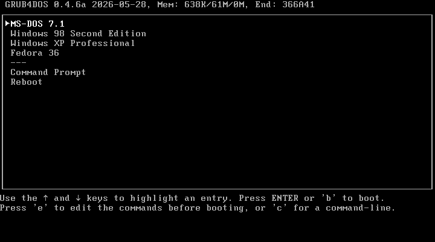
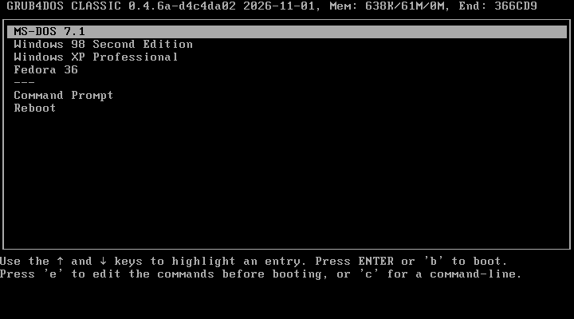

# grub4dos-classic

  

This project is derived from original work provided by [chenall](https://github.com/chenall), available in the [grub4dos repository](https://github.com/chenall/grub4dos). The source code has been modified and redistributed in accordance with the terms of the GNU General Public License, version 2.0, with appropriate attribution.

## Project Summary

The purpose of this fork is to restore the simpler visual design of the original grub4dos text-mode interface, as found in the early 0.4.4 and 0.4.5 releases. Over the years, various visual changes were introduced that gradually moved away from that original design. This fork aims to bring back the look and feel of the earlier versions.

Some of these changes could be reversed through customizations to `menu.lst`, but others could not. Restoring those aspects of the original interface required modifying the source code. In particular, the changes to menu highlighting behavior could not be replicated through `menu.lst` settings and therefore necessitated a fork of the project.

In addition to restoring the original interface, I have fixed a handful of minor bugs encountered during my own use of grub4dos.

Enjoy grub4dos again, the classic way!

## Screenshots

<table>
  <tr>
    <th colspan="2">Default Visual Style Comparison</th>
  </tr>
  <tr>
    <th>grub4dos</th>
    <th>grub4dos-classic</th>
  </tr>
  <tr>
    <td>
      
    </td>
    <td>
      
    </td>
  </tr>
</table>

<table>
  <tr>
    <th colspan="2">Boot Speed Comparison</th>
  </tr>
  <tr>
    <th>grub4dos (16s)</th>
    <th>grub4dos-classic (0.5s)</th>
  </tr>
  <tr>
    <td>
      
    </td>
    <td>
      
    </td>
  </tr>
</table>

## Version numbering

The release number follows the format:

`grub4dos-classic-0.4.6a-<sha1>-<date>`

The components identify the release as follows:

- **`grub4dos-classic`** – The name of this project.
    
- **`0.4.6a`** – The upstream grub4dos version that this release is based on.
    
- **`<sha1>`** – The Git SHA-1 hash of the upstream merge-base commit used as the starting point for this branch. This identifies the specific upstream code revision against which grub4dos-classic was developed.
    
- **`<date>`** – The date of the grub4dos-classic release, not the original release date of the upstream grub4dos version.
    

Including the merge-base SHA-1 makes it possible to identify which upstream revision a particular grub4dos-classic release incorporates, even when multiple releases are based on the same upstream version number.